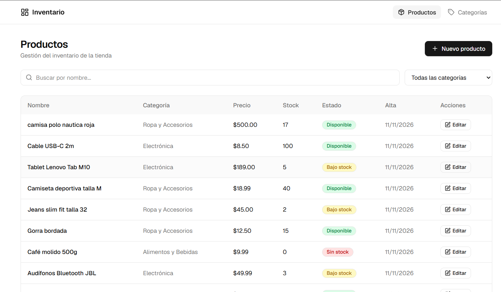
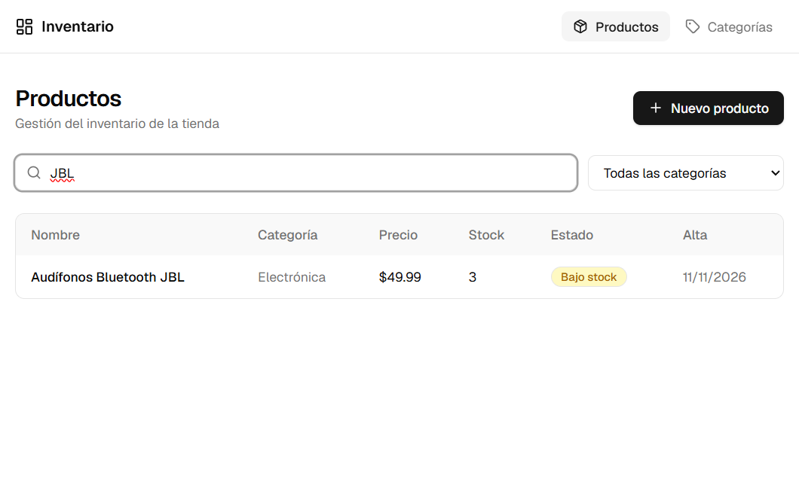
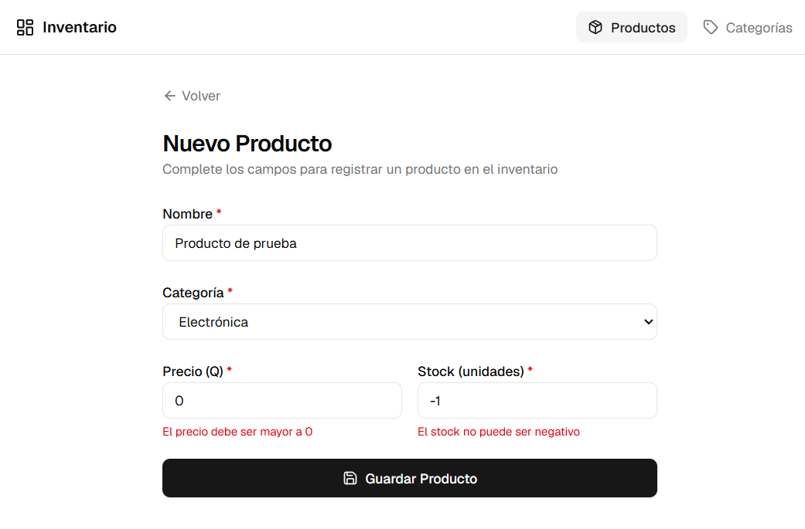
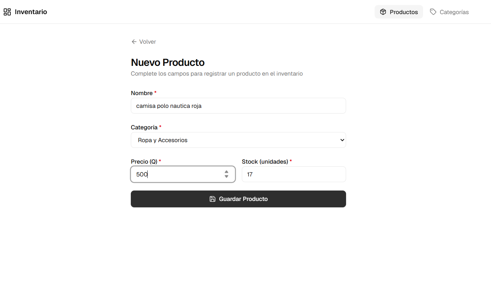
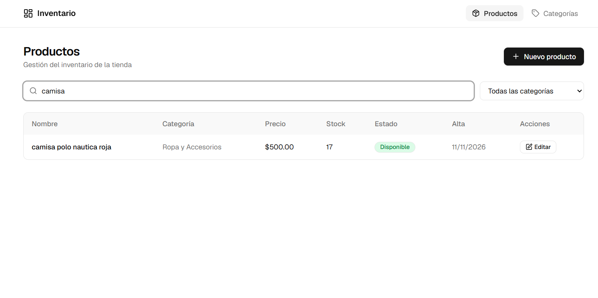
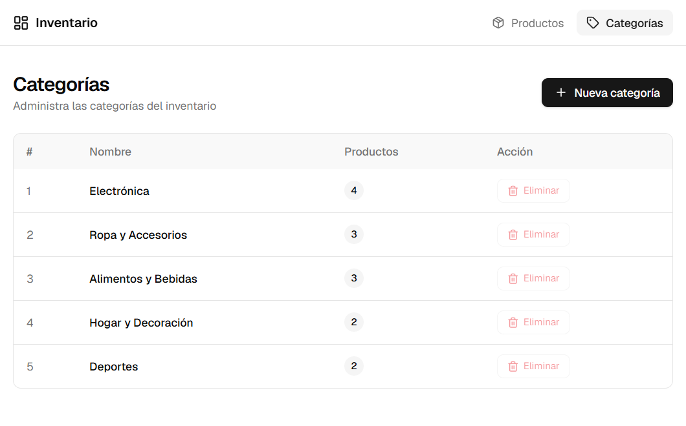
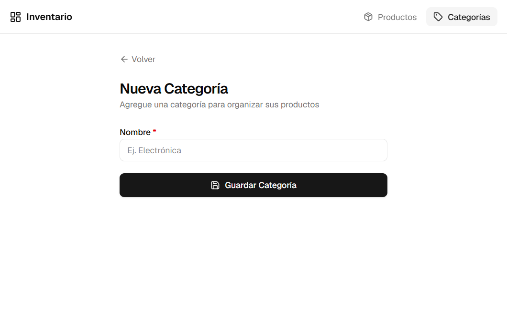

# Sistema de Gestión de Inventario

Aplicación web full-stack para el control de inventario de una tienda.
Permite visualizar productos, registrar nuevos elementos y aplica reglas de negocio
para el control de stock e integridad de categorías.

---

## Stack Tecnológico

| Capa | Tecnología | Justificación |
|---|---|---|
| **Backend** | Java 21 + Spring Boot 3.3 | Arquitectura en capas estándar, Spring Data JPA, Bean Validation y manejo centralizado de excepciones |
| **Base de datos** | PostgreSQL 16 | Motor relacional robusto, normalizado en 3FN con constraints (`CHECK`, `UNIQUE`, `FOREIGN KEY`) |
| **Frontend** | React 19 + TypeScript + Vite | SPA moderna, tipado estricto, Tailwind CSS v4, Lucide Icons y diseño responsivo |
| **Servidor Web** | Nginx Alpine (Reverse Proxy) | Servidor estático de alta eficiencia con redirección interna de `/api/` hacia el backend |
| **Contenedores** | Docker + Docker Compose | Despliegue agnóstico, reproducible y aislado con un solo comando |

---

## Requisitos Previos

- **Docker Desktop** (versión 4.x o superior) con Docker Compose habilitado.
> *Nota:* No se requiere tener instalado Java, Node.js ni PostgreSQL en la máquina host; los contenedores proveen los entornos de compilación y ejecución completos.

---

## Levantar el Proyecto con Docker

### 1. Clonar e ingresar al proyecto

```bash
git clone https://github.com/windows16/prueba-tecnica-inventario.git
cd prueba-tecnica-inventario
```

### 2. Construir y levantar los contenedores

```bash
docker compose up --build
```

*(Si se requiere reconstruir descartando capas anteriores, usar `docker compose build --no-cache && docker compose up`).*

### 3. Puntos de acceso

| Servicio | URL | Descripción |
|---|---|---|
| **Frontend (Web)** | [http://localhost](http://localhost) | Aplicación web completa de inventario |
| **Backend (API REST)** | [http://localhost:8080/api](http://localhost:8080/api) | Endpoints REST de Spring Boot |
| **Documentación Swagger UI** | [http://localhost:8080/swagger-ui.html](http://localhost:8080/swagger-ui.html) | Documentación interactiva OpenAPI 3 |
| **PostgreSQL** | `localhost:5432` | Base de datos (`inventario_db`) |

> En el primer arranque, PostgreSQL ejecuta automáticamente el script `database.sql` cargando las tablas normalizadas y los datos de prueba iniciales (incluyendo casos de bajo stock).

### 4. Detener la aplicación

```bash
# Detener contenedores preservando los datos de la base de datos
docker compose down

# Detener contenedores eliminando el volumen de datos
docker compose down -v
```

---

## Base de Datos e Inicialización

### Esquema y Normalización (3FN)

El modelo está normalizado en Tercera Forma Normal (3FN), eliminando redundancias y dependencias transitivas:

```
categorias                                productos
┌───────────────────────────┐             ┌────────────────────────────────────────────────────────┐
│ id: SERIAL (PK)           │◄────────────│ id: SERIAL (PK)                                        │
│ nombre: VARCHAR(100) (UQ) │             │ categoria_id: INT (FK -> categorias.id ON DEL RESTRICT)│
└───────────────────────────┘             │ nombre: VARCHAR(200) NOT NULL                          │
                                          │ precio: NUMERIC(10,2) CHECK (precio > 0)               │
                                          │ stock: INT CHECK (stock >= 0)                          │
                                          │ fecha_creacion: TIMESTAMPTZ DEFAULT NOW()              │
                                          └────────────────────────────────────────────────────────┘
```
---

## Estructura del Proyecto

```
prueba-tecnica-inventario/
├── backend/                             # API Spring Boot (Java 21)
│   ├── src/main/java/com/inventario/
│   │   ├── config/                      # Configuración de CORS y beans
│   │   ├── controller/                  # Endpoints REST (ResponseEntity, @Valid)
│   │   ├── dto/                         # Records DTO de entrada y salida
│   │   ├── exception/                   # GlobalExceptionHandler y excepciones de negocio
│   │   ├── mapper/                      # Transformaciones Entity <-> DTO
│   │   ├── model/                       # Entidades JPA (@Entity, @Table)
│   │   ├── repository/                  # Spring Data JPA Repositories
│   │   └── service/                     # Interfaces y lógica de negocio (@Transactional)
│   ├── Dockerfile                       # Multi-stage build con Maven y JRE 21 Alpine
│   └── pom.xml
│
├── frontend/                            # SPA React 19 + TypeScript + Vite
│   ├── src/
│   │   ├── components/ui/               # Componentes UI reutilizables (Badges, Alerts)
│   │   ├── features/
│   │   │   ├── categorias/              # Módulo de Categorías (pages, services, models)
│   │   │   └── productos/               # Módulo de Productos (pages, services, models)
│   │   ├── routers/                     # Enrutador y Layout de la aplicación
│   │   └── services/                    # Cliente HTTP Axios centralizado
│   ├── Dockerfile                       # Multi-stage: compilación Node + servidor Nginx
│   ├── nginx.conf                       # Configuración de proxy inverso y SPA fallback
│   └── package.json
│
├── database.sql                         # Script DDL + Seed data inicial
├── docker-compose.yml                   # Orquestación de servicios (db, api, web)
├── .env.example                         # Plantilla de variables de entorno
└── README.md                            # Documentación integral del proyecto
```

### ¿Por qué elegí esta estructura? (Decisiones de diseño)

Para este proyecto busqué orden, buenas prácticas y simplicidad, evitando complicaciones:

* **Backend por capas (Spring Boot):** Separé el código en controladores, servicios y repositorios para que cada clase tenga una única responsabilidad. Use DTOs para no exponer las tablas de la base de datos directamente al frontend y un manejador global de excepciones para que los errores devuelvan mensajes claros.
* **Frontend por caracteristicas(React):** En lugar de tener todos los archivos revueltos, agrupé todo lo relacionado a productos y categorias en sus propias carpetas (pages, services y models). Esto hace que el proyecto sea fácil de leer y mantener.
* **Base de datos (PostgreSQL):** La relación entre productos y categorías está en 3ra Forma Normal (sin datos repetidos). Además de validar en Java, configuré restricciones en la bd para asegurarlas.
* **Docker y Nginx:** Usé Docker Compose para que cualquier persona pueda probar el proyecto con un solo comando. Nginx se encarga de servir la web y hacer de puente hacia el backend, evitando problemas con cors o configs de puertos.

## Requisitos Funcionales y Reglas de Negocio

### RF-01. Listado de Productos (Vista principal)

Mostrar una tabla o tarjetas con: Nombre, Categoría, Precio, Stock y Estado.

**Filtro simple:** Un buscador por nombre o un filtro desplegable por categoría.

### RF-02. Crear Producto

Formulario para registrar un producto asignándole una categoría existente.

**Validaciones obligatorias:**

- El nombre no puede estar vacío.
- El precio debe ser mayor a 0.
- El stock no puede ser negativo.

### Regla de Negocio (Lógica a evaluar)

Si el stock de un producto es menor o igual a 5, la interfaz debe mostrar una
alerta visual en CSS (ejemplo: texto o etiqueta en color rojo/amarillo indicando
**"Bajo Stock"**).

No debe permitirse eliminar una categoría si todavía tiene productos asociados
(o manejar el error adecuadamente sin que la app colapse).

---

## Casos de Uso, Escenarios de Prueba y Evidencia

### CU-01: Visualización y Filtrado de Inventario (RF-01)
* **Escenario 1.1 (Listado general):** Al ingresar al sistema, se muestra la tabla con Nombre, Categoría, Precio, Stock y Estado de cada producto.
* **Escenario 1.2 (Filtro por búsqueda/categoría):** Al escribir un término (ej. "JBL") o seleccionar una categoría, la tabla filtra inmediatamente los resultados coincidentes.


*Figura 1: Vista principal con inventario completo y estados visuales.*


*Figura 2: Búsqueda dinámica filtrando productos coincidentes.*

---

### CU-02: Alerta Visual de Bajo Stock — Regla de Negocio (RF-04)
* **Escenario 2.1 (Alerta de Stock Crítico):** Si el stock es menor o igual a 5 unidades (o 0), la columna "Estado" resalta con una etiqueta visual de advertencia (`Bajo Stock`) en color rojo/amarillo.
* **Escenario 2.2 (Stock Normal):** Productos con stock mayor a 5 muestran el indicador verde (`Disponible`).

*(Referencia visual observable en la Figura 1: productos con stock ≤ 5 marcados con alerta).*

---

### CU-03: Registro y Validación de Producto (RF-02)
* **Escenario 3.1 (Validaciones obligatorias):** Si se intenta guardar con campos vacíos, precio menor/igual a 0 o stock negativo, el sistema bloquea el envío y muestra los errores correspondientes sin recargar la página.
* **Escenario 3.2 (Registro exitoso):** Con los datos válidos y categoría seleccionada, el producto se guarda correctamente y se refleja en el inventario.


*Figura 3: Validación de campos obligatorios en el cliente y servidor.*


*Figura 4: Ingreso de datos cumpliendo las reglas de negocio.*


*Figura 5: Producto registrado y visualizado en el listado.*

---

### CU-04: Gestión de Categorías y Restricción de Integridad (RF-05 / RF-06)
* **Escenario 4.1 (Creación de categoría):** Permite registrar una categoría con nombre único para clasificar nuevos productos.
* **Escenario 4.2 (Restricción de eliminación):** No se permite eliminar categorías que tengan productos asociados; el sistema maneja la restricción controladamente mostrando mensaje informativo sin colapsar.


*Figura 6: Listado de categorías con contador de productos asociados y bloqueo de borrado.*


*Figura 7: Formulario de alta para una nueva categoría.*
